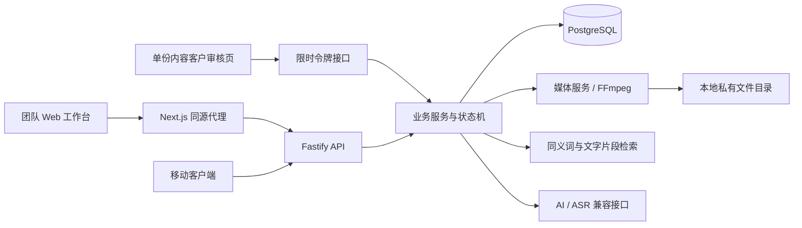

# 架构与演进

## 个人创作室

首页使用 `studio_sessions` 持久化每段对话的作品、引用、修订关系和画布。第一次发送或添加素材时复用项目 ID 建立创作记录，旧项目也能直接打开；业务审核与交付位于 `/archive`。本部署使用站点口令，个人创作室共享一套数据。

`studio-writing.ts` 为文本创作组装前文与最新编辑稿。配置视觉模型后，视频按时长抽取三个 JPEG 参考帧，并附上已有逐字稿。生成前和保存时校验引用素材授权。已完成作品与上传文件、字幕、配音及旁白成片在资产页汇总。

## 独立视频旁白（2026-11-09）

- `/narration` 使用独立界面、`narrations` 和 `narration_renders` 表，不写入商家、项目或素材资产表；只共享现有音色、媒体存储和受保护下载能力。新增表在 PostgreSQL / SQLite 初始化时创建，兼容旧 SQLite 数据迁移。
- `narration-media.ts` 通过 FFmpeg 转场检测与有界时间窗口建立原片时间线，每段提取两张有时间标记的 JPEG。画面 `shots` 与旁白 `segments` 分开存储；视觉 API 描述镜头并按语义生成段落，每段可覆盖多个相邻镜头。严格校验镜头 ID、顺序与旁白引用范围，字数仅对整片提供建议，不按单个镜头拒绝文案。原片时间轴不变，画面文字不作为指令。默认 `qwen3.8-flash`，支持独立 `VISION_*` 配置或复用百炼 ASR 凭据。
- `narration-worker.ts` 独立执行持久化分析与成片任务；租约、心跳、提交标记和中间片段支持重启接管，未知付费提交不自动重提。模型返回的分镜保存后才排队第一版视频，编辑不触发语音服务。成片捕获不可变的分镜版本与声音设置。
- 片段键使用固定顺序归一化后的有效表达，兼容 PostgreSQL JSONB 重排；试听复用内存缓存，新版本与重启任务可复用已保存的中间音频。先解码 24 kHz 单声道 PCM，以约 -45 dB 的 10 ms RMS 窗口修剪首尾静音，保留 40 ms 边缘与句中停顿，再按真实长度安排时间。`narration-timing.ts` 以 1.85 秒调度上限给编码、变速与边缘留出余量，将片头、段间和片尾留白控制在 2 秒内；剩余时间在有容量的停顿间分配，避免长片尾静音移到中间。必要时统一 0.85–1.35 倍变速，内容不足则提示补充；超长会停止后续付费请求并保留片段。成片记录不可变 `alignedSegments`，MP4 和 VTT 均使用实际安排的字幕时间；旧记录、草稿和导出保留兼容。
- 分镜草稿按视频版本保存在当前浏览器，服务端以修订号做乐观并发检查；冲突时保留本机修改并提供加载最新版本。原片、缩略图、成片和字幕接口继承站点鉴权、写入来源校验及 Range 下载。音色有活动旁白任务时不能删除。

- `narration-translation.ts` 复用通用 AI 凭据，使用独立字幕翻译提示词，只传文本短句；按字幕源文和语言缓存译文，尊重手改非空内容，未知付费提交由成片任务持久化保护。缓存作为派生信息不修改文案修订号，手改译文参与规范化版本比较。
- `shared/narration-captions.ts` 生成共用时间轴的中英短句、SRT/VTT 与 ASS；FFmpeg/libass 将参考样式写入画面，同时导出无字幕成片。中文字体由容器的 `fonts-noto-cjk` 提供，固定字体名称与安全转义避免字幕内容注入排版指令。下载文件沿用鉴权和 Range；旧版软字幕不被替换，浏览器对已写入画面的字幕不叠加原生字幕轨。

## 个人音色与配音（2026-11-07）

- `use-dubbing-draft.ts` 在客户端挂载后读取版本化本机草稿，完成恢复后才启用自动保存，并在 `pagehide` 补写当前状态，避免空表单覆盖已有草稿。`shared/dubbing-draft.ts` 校验有界草稿结构，允许未完成句子；原始录音、File、授权、请求凭据不进入本机草稿。已删除的音色引用在快照刷新后清除。
- `DELETE /api/voices/:id` 在事务中与创建 / 配音排队互斥，远程音色使用持久化删除标记并由现有 worker 处理；`remoteDeletedAt` 保存成功确认后再清理原录音和记录，失败可手动继续，不回退到创建任务。公开状态为删除中 / 删除失败，历史配音无外键级联删除。

- `dubbing-script.ts` 共享分句、手动边界保留、逐项继承和试听范围解析；服务端严格校验全文与分段一致、句子编号和长度范围。局部覆盖以结构化字段保存，不允许注入任意供应商指令。
- `speech-clips.ts` 提供试听 / 完整任务共用的有界内存片段缓存，键包含账户、模型、音色、文本和有效表达，停顿在拼接层处理。`dubbing-audio.ts` 解码为统一 PCM 再拼接，清理临时目录。完整任务的 `clipResults` 持久化未知提交、已知结果地址与本地中间片段，恢复不重合成已完成句子；成功后清理中间媒体。公开快照仅返回分段设置和进度。
- `dubbing-script-editor.tsx` 提供句子选择、逐句文案、光标拆分、合并、局部表达和清除标记，整篇编辑保留未修改句子。试听状态签名按实际所选片段计算，修改无关片段不丢弃本句试听。

- `shared/dubbing-settings.ts` 定义语速、音高、语调和情感的统一设置、标签、默认值及预设指令；`server/dubbing-settings.ts` 提供共用校验。预览与完整生成最终调用同一个供应商参数构建，语调 / 情感映射到 `instruction`，音高映射到 `pitch`。不支持指令的模型在调用前拒绝非默认表达选项。
- 表达设置随 `dubbings.data` 保存，重试和任务恢复使用记录内的原值；旧记录通过默认值归一化兼容。预览缓存键与前端预览状态包含全部设置，修改参数后停止旧音频并取消旧等待。

- `dubbing-preview.ts` 提供独立的短试听接口：仅合成文案前部，FFmpeg 裁剪约 5 秒后以音频响应返回。过程不写数据库，临时目录在返回前清理；API 内的有界缓存保留 10 分钟，相同请求号防止重复提交，同参数结果可复用。`DubbingPreview` 负责浏览器 Blob 播放和参数变化 / 取消时的清理，不触发正式生成。

- `voice-sample-picker.tsx` 提供默认网页录音与文件上传。原生 MediaRecorder 采集后由 OfflineAudioContext 解码并转换为单声道 24 kHz WAV，用户试听确认后复用音色保存接口，不增加业务耦合。录音关闭、取消、停止或失败后释放轨道；过期授权与解码回调不更新已关闭弹窗。

- `personal-dubbing.tsx` 提供文本输入、视频转写导入、音色上传与复用、配音记录、试听下载，由工作台中的 `dubbing-tool.tsx` 容器按当前项目获取快照并刷新后台状态。音色在团队内复用。工作台内的配音与抖音字幕均可通过 `projects/:id/tool-assets` 保存为项目素材，重复保存同一结果和版本复用已有记录。
- `tts.ts` 仅在后端调用百炼 `voice-enrollment` 创建 / 查询音色和 `SpeechSynthesizer` 合成 MP3，录音转换为 WAV 后以 Data URI 提交。结果地址只允许百炼存储域名或与本地测试服务同源的回环地址，不向存储下载请求转发 Key。
- `dubbing.ts` 管理独立的 `voices` / `dubbings` / `dubbing_sources` JSONB 记录、请求编号去重与租约，`dubbing-worker.ts` 随 Fastify 启动。音色编号绑定创建时模型及服务凭据指纹，公开快照剔除这些内部字段和供应商临时链接。
- 外部请求前持久化提交标记，创建返回后立即保存音色编号 / 合成结果链接。过期租约可接管已知结果的查询和下载；无法确认付费提交结果时不自动重提。下载中断可使用原结果重试，地址失效后明确要求人工重试合成。
- 原录音、上传的视频与完成的 MP3 使用私有媒体卷。用户选择存入当前项目后，素材记录引用已生成的 MP3，字幕和转写文稿则保存当时的版本。独立文件接口提供带鉴权的范围播放和下载，文案直接保存于配音记录。
- PostgreSQL 新增三张不含项目外键的独立表，SQLite 测试适配器同步增加表；导入旧 SQLite v3 时允许不存在这些新表，既有八类数据迁移行为保持。
- 系统 Chrome 和本地模拟服务覆盖两种文案来源、音色复用、后台生成、音频加载、下载和 390px 布局。另使用百炼官方示例录音完成真实接口测试，包括音色创建、中英文合成、视频转写与配音，生成结果再次识别核对。本人音色相似度需使用自己的录音试听。

## 当前设计

Next.js 提供 React / shadcn 页面及同源流式代理，Fastify 独立提供业务 API 和后台转写，正式业务数据保存在 PostgreSQL，媒体文件继续使用私有数据卷。详见 [Fastify 与 PostgreSQL 后端](docs/FASTIFY_POSTGRESQL.md)。



## 代码边界

| 位置 | 职责 |
| --- | --- |
| `src/app/` | 页面路由及到 Fastify 的同源流式 API 代理 |
| `src/api/`、`src/server/http.ts` | 独立 Fastify 启动、请求上限、来源检查、口令鉴权、客户审核和文件 Range 响应 |
| `src/components/` | 工作台、通用交互与独立客户审核页，响应式界面 |
| `src/shared/types.ts` | 两种业务、资产、片段、内容、拍摄任务与审核记录的共享类型 |
| `src/server/db.ts` | PostgreSQL 初始化、JSONB / 外键 / 索引、异步参数化读写、事务、旧库导入 |
| `src/server/service.ts` | Zod 校验、项目范围限制、素材引用检查、审核与交付状态机、操作日志 |
| `src/server/media.ts` | 文件验证、媒体探测、缩略图、ASR 提取、真实 MP4 区间粗剪 |
| `src/server/asr.ts` | 百炼临时上传 / 异步转写 / 查询、错误脱敏、句词时间与说话人归一化 |
| `src/server/transcription-queue.ts` | 上传事务内入队、授权等待、租约抢占和公共状态 |
| `src/server/transcription-worker.ts`、`src/api/main.ts` | 服务启动时后台调度、识别、恢复和终态处理 |
| `src/server/search.ts` | SRT / 逐字稿导入、规则标签、同义词扩展与片段排序 |
| `src/server/ai.ts` | 真实 AI 适配、返回结构校验、来源约束、明确标注的演示策划 |
| `tests/`、`scripts/` | 隔离业务、HTTP 和系统 Chrome 验收 |

## 数据与一致性

商家 → 项目 → 素材 / 内容 / 任务 / 活动。关系 ID 使用外键，实体数据使用受类型和输入校验约束的 JSON 保存。旧 SQLite 结构版本 `user_version=3`，素材、内容、任务的项目键有索引。既有 v1 表保持不变，v2 添加远端任务表 `asr_jobs`，v3 添加后台队列 `transcription_jobs` 及到期索引；删除素材会级联删除两种任务记录。

短事务维护状态与日志的一致性；FFmpeg、ASR 和 AI 调用在事务之外等待。外部生成返回后再次核对素材归属与授权，避免等待期间失效。转写返回后发现人工逐字稿已改动时拒绝覆盖。当前 PostgreSQL 使用异步仓储、JSONB 记录、外键和索引，事务使用独立连接和请求上下文；旧库一次性导入保留 ID、排序与转写任务。显式 SQLite 测试适配器用于快速隔离验收。

所有业务值使用 SQL 参数绑定。表名仅来自内部 TypeScript 联合类型，不接收请求提供的表名。没有多商家用户身份；项目 ID 过滤和跨项目引用约束只是内部业务边界。

## 审核状态机

```text
草稿 ──提交──→ 待审核 ──通过──→ 已通过 ──拍摄项目──→ 已交付
                 │                └─代运营──→ 已排期 ──手动确认──→ 已发布
                 └─修改意见──→ 待修改
任意内容保存修订 → 新版本草稿，撤销旧链接、排期与原审核结果
```

- 审核写入必须携带内容版本，重复或无效状态变更返回冲突。
- 客户令牌随机生成 24 字节（48 位十六进制），有效期 7 天；只读取单份内容和关联媒体，可通过或提出修改意见。
- 修订保留历史审核记录及原始生成来源，重新走审核；新提交会轮换链接。
- 提交、通过、交付、排期和导出前核对当前来源授权。媒体未关联时，只能声称交付脚本与文案，不能声称已交付成片。
- 代运营不允许走拍摄交付状态，拍摄交付项目不允许排期。发布时间统一按北京时间输入与展示，以 ISO 时间保存。

## 媒体处理边界

原文件按随机 ID 保存，文件接口按数据库记录解析，不接受任意磁盘路径。图片检查签名，视频 / 音频在 ffprobe 可用时校验轨道。文件类型白名单排除 HTML 和 SVG 等活动文档。媒体支持单区间 Range 读取，可在浏览器拖动播放。

ASR 仅在接口配置齐全时调用，不生成虚构逐字稿。SRT 保留时间码；普通文稿时间设为 null。规则标签不是视觉识别。粗剪只截取一个视频区间、重新编码并继承创建时的授权信息，不含镜头识别、画面理解、字幕烧录、配乐或多片拼接。原素材后续撤销授权时，应同步检查衍生文件授权；本版没有跨衍生链自动传播机制。

上传、媒体探测和缩略图在请求内完成，ASR 在上传后异步处理；单文件上限、处理超时和提取音频上限均有明确错误提示。文件写入与数据库不构成跨系统原子事务，进程意外退出可能留下孤立文件；删除索引时保留物理文件。本版不提供清理或恢复后台作业。

## 接口概览

默认所有团队接口同一个共享访问口令（若配置）；`/api/health`、登录接口、按令牌访问的客户审核接口除外。

| 方法 | 路径 | 用途 |
| --- | --- | --- |
| GET | `/api/health`、`/api/snapshot` | 可用性、工作台数据与服务配置状态 |
| POST | `/api/session` | 校验团队口令并设置 HttpOnly Cookie |
| POST | `/api/merchants`、`/api/projects` | 建档 |
| POST / PATCH / DELETE | `/api/assets`、`/api/assets/:id` | 上传、标签 / 授权 / 逐字稿、移除索引 |
| POST | `/api/assets/:id/transcribe` | 异步重试 / 历史素材手动排队，HTTP 202 返回素材与状态 |
| POST | `/api/assets/:id/cut` | FFmpeg 粗剪 |
| GET | `/api/search?projectId=…&q=…`、`/api/files/:id` | 项目片段检索、媒体读取或下载 |
| POST | `/api/generate` | 基于素材生成选题文案 |
| PATCH | `/api/contents/:id` | 乐观版本校验并保存新版本 |
| POST | `/api/contents/:id/transition` | 审核、交付、排期、人工发布确认 |
| GET | `/api/contents/:id/review-link` | 团队获取仍有效的客户链接 |
| GET / POST | `/api/review/:token` | 客户读取 / 提交单份审核 |
| GET | `/api/review/:token/media` | 客户读取单份内容关联媒体 |
| POST / PATCH | `/api/tasks`、`/api/tasks/:id` | 新建拍摄任务与勾选状态 |
| DELETE | `/api/contents/:id` | 删除单条草稿，需要项目 ID 与内容版本 |
| POST | `/api/contents/bulk-delete` | 明确 ID / 版本列表的批量草稿删除，最多 200 条 |
| GET | `/api/projects/:id/delivery` | 审核通过内容的 JSON 交付清单 |

## 分阶段演进（未实现）

1. **可协作的内部部署**：账号 / 角色 / 项目成员、HTTPS、登录限速、令牌撤销与通知、备份恢复演练。
2. **生产媒体链路**：OSS / S3 直传、分片续传、代理视频、BullMQ / Redis 后台任务、幂等重试、失败恢复、存储清理与授权撤回传播。
3. **数据库与检索扩展**：独立 Fastify 与 PostgreSQL 已完成；后续可细化关系模型、版本化迁移、pgvector、关键词与向量融合检索。
4. **真实智能加工**：可验证的视觉标签、镜头切分、精彩片段提取、多素材时间线、字幕和人工精剪确认。
5. **运营闭环**：平台授权、人工确认后的发布集成、真实经营指标录入与归因、内容复盘。当前没有自动发布或经营效果承诺。

## Docker 交付

使用 Next.js standalone 网页、Fastify API 和 PostgreSQL 三个服务。FFmpeg / ffprobe 与私有媒体卷归 API，数据库使用独立 PostgreSQL 卷；Web 不持有模型 Key、数据库连接或媒体卷。镜像不带入本机数据和密钥，应用容器非 root，宿主机默认仅开放 127.0.0.1:3100。详细运维与验证见 [DOCKER.md](DOCKER.md)。

未来移动客户端可继续调用现有后端 API，并共享数据类型和可移植的业务规则。当前 React 页面使用 DOM / CSS，原生展示组件需要单独适配；原生客户端认证、跨来源访问和 API 地址配置也需要单独设计，当前未实现移动 App。

## shadcn/ui 组件层

在现有 Web 界面引入官方 New York v4 / Radix registry 组件，源码位于 `src/components/ui/`。Tailwind CSS v4 由 PostCSS 在构建时生成，品牌色与主题 token 位于 `src/app/shadcn.css`，原有业务布局样式继续位于 `globals.css`。

业务适配层 `src/components/ui.tsx` 负责：把字段 Label 与输入控件关联、把 Select 的交互值转换为已有 FormData 值、在受控弹窗关闭时将焦点还给打开按钮。空的媒体关联选项在界面层映射为内部占位值，提交时仍还原为空字符串，不向接口传入占位 ID。

素材类型用 Tabs；拍摄任务和来源素材用 Checkbox；项目模式用 RadioGroup；素材移除用 AlertDialog。共享 Button / Input / Textarea / Badge / Dialog 同时用于团队和客户页面。后端接口、数据库结构、审核版本与交付状态机未因本次 UI 改造而改变。

## 草稿删除

单条与批量接口共用 `deleteDrafts`，限定当前项目中 `draft / changes_requested` 的记录。先在短事务内核对整批记录、项目归属、状态与版本，再删除并写操作日志；任一项失败回滚整批。删除只移除内容记录（含其 JSON 内的版本审核历史），不删除来源资产或关联媒体文件。原客户审核链接随记录删除失效。

Web 使用 shadcn Checkbox、Button 与 AlertDialog 选择并确认标题，支持取消、焦点恢复及手机布局。客户端只提交明确选择的 ID / 版本，不存在无条件删除全部内容的接口。

## 百炼 ASR（2026-11-05）

`ASR_PROVIDER=aliyun` 选择百炼文件转写；配置独立 ASR Key、同地域 API 地址与模型。媒体服务提取单声道 16kHz FLAC，使用百炼临时上传接口获得仅供目标模型使用的 URL，再提交异步识别；任务查询成功后下载 JSON，保留句级 / 词级起止秒数、词后标点和说话人编号。原片时间轴不做静音裁剪，粗剪时词级时间随区间一起裁切和平移。

`asr_jobs` 保存已知任务编号、地址 / 模型、输入指纹和提交时间，网络错误或单次查询超时保留任务，后台继续查询仍有效的已知任务。成功或终态失败清理任务；未知状态不自动重新提交。单进程内并发请求共享 Promise。输入指纹校验与授权复查阻止等待期间覆盖人工改稿或撤权素材。此机制配合持久化后台队列运行。提交请求发生不确定的网络中断且未取得编号时，无法保证上游没有创建任务，因此不会自动重新提交。

API Key 仅用于已配置的 API 地址；上传表单与结果下载不携带该 Key，存储地址要求 HTTPS 阿里云域名且拒绝跳转。错误仅返回阶段、状态码和有限的服务错误代码，不透传凭证、签名 URL 或供应商正文。临时文件适用于本地 MVP 验收；正式生产使用自有 OSS。相关协议见 README 中的官方链接。

已实现句级文字检索与定位；词级索引数据已保存。命中后自动截帧、DeepSeek 图像理解、无声素材视觉索引和向量语义检索尚未实现。

## 自动后台转写队列（2026-11-05）

新媒体与队列在同一上传事务保存，接口不等待 ASR。状态包括等待授权 / 配置、排队、处理中、继续查询、完成、失败、人工稿保留和无音轨跳过。仅新增媒体自动入队，不批量回溯未转写历史素材；待授权记录确认后自动排队。

使用 Fastify 启动入口启动 Worker，默认每 750ms 检查，单个后台任务并发。PostgreSQL 短事务原子抢占，30 秒租约、5 秒续期；更新使用令牌条件，旧租约不能覆盖新所有者。正常退出释放任务，强制终止后租约到期可接管。已知百炼任务恢复时继续查询；过期、配置变更或提交不确定则失败等待明确重试。适用于当前持续运行的本机 / Docker 服务，尚非跨主机队列或 Serverless 方案。

完成状态、句词时间码和标签在同一事务保存。人工改稿、撤权和删除使任务失效，后台复查输入指纹、授权和租约。浏览器轻量刷新状态，不设置全局忙碌，未保存输入保留；关页不停止后台。

验证：`npm test` 覆盖强制终止进程后的同任务恢复；`HUB_TEST_DOCKER_IMAGE=merchant-content-hub:local npm run test:transcription` 使用隔离数据和本地模拟 ASR，验证非阻塞导航、异步重试、关页继续和手机显示。数据库事务使用同一连接，参考 [node-postgres 官方说明](https://node-postgres.com/features/transactions)。

## 创作素材范围与来源展示（2026-11-05）

`src/shared/creation-sources.ts` 为界面和 AI 服务共用可用条件：同项目、已授权、未过期。手动模式从全部可用文件中明确选择最多 30 份；自动模式保持资产查询顺序并取前 30 份。界面展示相应名单和文字可用状态，生成前的参考范围与生成后的实际引用分别命名。模型返回的来源 ID 只允许来自实际发送的候选集合，避免引用未进入上下文的同项目文件；生成完成入库前继续复核授权与归属。

创作台和审核卡片显示每条内容实际引用的文件名，并可打开同项目详情。预览按钮是普通非提交按钮，不会调用模型；转写中的素材说明暂时依据名称 / 标签，已有文字和演示资料分别标明。画面识别和自动成片仍未接入。

## 生成前的手动参考条件（2026-11-05）

浏览器与生成接口默认手动模式，自动模式须明确选择。`eligibleCreationSources` 提供本项目全部合法候选；`resolveCreationSources` 对显式 ID 列表验证空值、重复、上限与有效性，再构造唯一允许提供给 AI 的输入集合。手动选择不先截断到自动前 30 份，模型上下文与输出引用均限制在所选集合。自动模式不接受同时指定 ID，以避免客户端条件被静默忽略。

React 中的模式与所选 ID 绑定当前项目；切换项目清空选择，新增文件不加入手动范围。候选刷新后保留失效 ID 并阻止生成，让用户明确移除；生成请求被服务端拒绝后刷新候选，不自动换材。生成期间禁用选择控件，保持请求条件稳定。

服务端在调用模型前完成选择校验，结果入库前复核所有已经发送的参考素材；即使某个输入文件没有出现在模型最终引用列表里，生成期间撤权也会拒绝保存。`test:creation` 用隔离 Docker / 演示模板验证页面的勾选、全选清空、模式切换、失效处理和手机布局；真实模型的请求内容与拒绝边界通过本地 HTTP 桩验证。

## 素材搜索分组与页面状态（2026-11-05）

搜索仍由服务端依据同项目的已授权、未过期素材进行文字与同义词匹配，全局返回最多 30 个匹配项。前端按素材 ID 合并，组的顺序保留首次命中的相关性顺序，组内有时间码的片段按时间升序展示。文稿与无时间码内容可查看但不伪造定位时间。

请求使用 AbortController 与请求版本检查；返回列表、清空、全部素材、导航及项目切换同时清理查询、结果、等待状态和类型。搜索等待不使用全局业务 busy。搜索完成时单独保存所执行的搜索词，避免输入框修改后误标当前结果。点击片段传递开始秒数至素材详情，媒体元数据加载后定位，关闭详情不清理结果。
