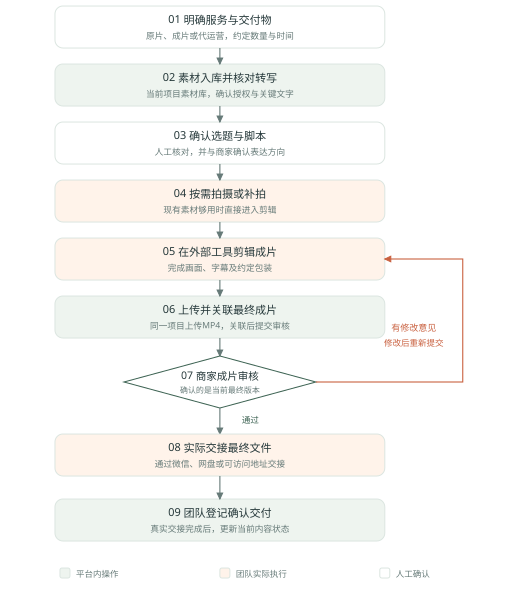

# 商家内容制作与交付流程

更新日期：2026-11-06（Asia/Shanghai）  
适用范围：当前片场 FIELDWORK Web MVP；策划、摄影师、剪辑师、运营及项目负责人。

先明确商家购买的是原片、剪辑成片还是代运营服务，再安排制作、审核、文件交接和系统登记。**“确认交付”应在实际文件交接完成后操作。当前按钮只登记内容状态及操作记录，不会自动制作、发送文件或核实商家是否收件。**

## 先明确实际交付物

| 服务约定 | 实际交付物 | 完成要求 |
| --- | --- | --- |
| 只负责拍摄 | 按脚本拍摄并整理的原始视频、录音与素材清单 | 按镜头或主题整理，核对文件数量与可播放性 |
| 拍摄并剪辑 | 最终成片，以及约定包含的发布文案、封面或字幕文件 | 确认最终版本，并完成实际文件交接 |
| 代运营 | 审核后的内容、排期、实际发布记录及约定的运营服务 | 按运营周期跟进；不走拍摄项目的确认交付路线 |

当前项目模式只有“拍摄交付”和“代运营”。只拍摄与拍摄剪辑都使用拍摄交付模式，具体交付物需写进项目目标或业务约定。拍摄交付按约定交接原片或成片；代运营审核后继续排期、人工发布与记录。

## 拍摄与成片交付流程图

适用于约定交付剪辑成片的项目。现有素材能覆盖脚本时可直接利用，不足的镜头再补拍。

[可编辑的 Mermaid 流程图源码](assets/delivery-workflow.mmd)

商家有修改意见时，回到剪辑或改稿环节；上传或调整关联成片、保存新版本后，再次提交审核。只有确认了最终版本，并完成实际文件交接，才登记交付。

## 每一步由谁完成

| 环节 | 负责人 | 页面或工具 | 完成标志 |
| --- | --- | --- | --- |
| 明确约定 | 项目负责人 | 商家与项目及沟通记录 | 写清原片还是成片、交付数量、格式和时间 |
| 素材入库 | 摄影师及运营 | 素材资产库 | 视频归入正确项目，授权和关键转写文字已核对 |
| 脚本确认 | 策划及商家 | AI创作台及客户审核页 | 本次选题、脚本方向与所用资料已确认 |
| 拍摄补拍 | 摄影师 | 拍摄任务及现场执行 | 所需人物口播、产品特写和场景镜头齐备 |
| 剪辑成片 | 剪辑师 | 剪映或PR等外部工具 | 导出可播放的成片，完成字幕及包装核对 |
| 关联成片 | 运营或剪辑师 | 素材资产库及编辑与关联成片 | 成片已上传，内容记录关联的是正确最终文件 |
| 成片审核 | 商家及运营 | 审核与交付及客户审核页 | 确认最终版本；修改后重新提交审核 |
| 实际交接 | 项目负责人 | 微信、网盘或可访问的下载地址 | 约定文件可以获取和播放，记录交接渠道与版本 |
| 登记交付 | 项目负责人 | 审核与交付中的确认交付 | 真实交接完成后，将当前内容登记为已交付 |

平台用于归档、协作、引用和记录。拍摄、精剪、对外沟通和实际文件交接由团队执行。当前只有单片段粗剪，正式字幕、包装和多镜头精剪主要使用剪映、PR等外部工具。

## 当前按钮各自做什么

| 按钮 | 实际作用 | 需要注意 |
| --- | --- | --- |
| 提交审核 | 让商家确认当前版本的脚本、文案及已关联成片 | 审核链接有效期7天；保存修订后要重新提交 |
| 确认交付 | 把已通过内容登记为已交付，并记录操作人、时间和版本 | 不自动发送文件，不核实商家是否收件；未关联成片也能登记 |
| 导出交付清单 | 导出审核通过内容、脚本文案及关联文件链接的JSON清单 | 不是视频压缩包；没有关联成片时，清单没有最终成片文件 |

“已交付”描述这一条内容的登记状态，不自动代表整个项目已完成全部交付。未关联成片时，系统只有脚本和文案，不能据此认定已完成成片交接。

同一条内容可以先确认脚本，再关联成片并确认最终视频。当前系统没有独立的脚本审核阶段与成片审核阶段；关联成片或修改内容并保存后，记录回到新版本草稿，原审核链接失效，需要重新提交审核。

## 代运营审核后的路线

[可编辑的 Mermaid 流程图源码](assets/managed-publishing-workflow.mmd)

审核通过后设置排期，由团队到目标平台实际发布，再回内容日历确认已发布。排期用于协作，当前不会自动发布到抖音、小红书或视频号。

## 锂电池项目操作示例

以现有约34秒的三轮车锂电池口播为基础，本轮测试目标为1条选购科普短视频。讲清选购需结合载重、行驶距离、坡路、容量与放电能力。

1. 在“三轮车锂电池选购科普”项目中选择现有约34秒口播，核对人名称呼及字幕。
2. 围绕载重、行驶距离、坡路、容量和放电能力生成脚本，再确认本次表达。
3. 按需补拍产品和用车场景，在剪辑工具中制作成片并核对字幕。
4. 将最终MP4上传到同一项目，在“编辑与关联成片”中关联，保存后提交成片审核。
5. 商家通过后交接最终视频及约定文案，完成交接再点击“确认交付”。

真实店名、城市、报价和工期仍待确认。费用0为未报价占位，数量1为本轮测试目标，不代表已签订的服务约定。原片是否交付，也需写入实际约定。

## 交付前核对

- [ ] 本次交付的是原片还是成片，双方理解一致。
- [ ] 最终文件可打开，数量、画幅、清晰度和字幕符合约定。
- [ ] 人名、品牌、型号、价格等关键内容已由商家确认。
- [ ] 商家确认的版本与实际交接的文件一致。
- [ ] 收件方已获得文件或可访问的下载方式。
- [ ] 团队已记录交接日期、渠道、收件方和版本，再登记交付。

交接渠道、收件方和收件确认建议另用交接记录保存；当前没有独立的客户签收回执。商家审核通过与实际获取文件是两个不同环节。

## 当前系统的使用边界

- 未关联成片也允许登记交付；团队应按实际约定判断交付物是否齐备。
- 导出的JSON是内容和文件链接清单，不是包含实际视频的压缩包。
- 审核链接有效期7天，修订后旧链接失效，需重新提交。
- 本机的127.0.0.1地址不能直接给外地商家访问。可先通过微信或网盘交接文件；使用客户审核链接，需要部署到商家可访问的地址。
- 当前不自动精剪、对外发送文件、获取签收回执或发布社交平台内容。

## 文档维护

业务行为依据当前内容状态机、成片关联表单、客户审核页面和交付清单导出逻辑核对。相关实现：`src/server/service.ts`、`src/components/workspace.tsx`、`src/components/review-portal.tsx`。应用流程调整后，应同步本说明、两份Mermaid源码、SVG流程图及PDF版本。

[适合阅读和转发的PDF版本](商家内容制作与交付流程.pdf)
