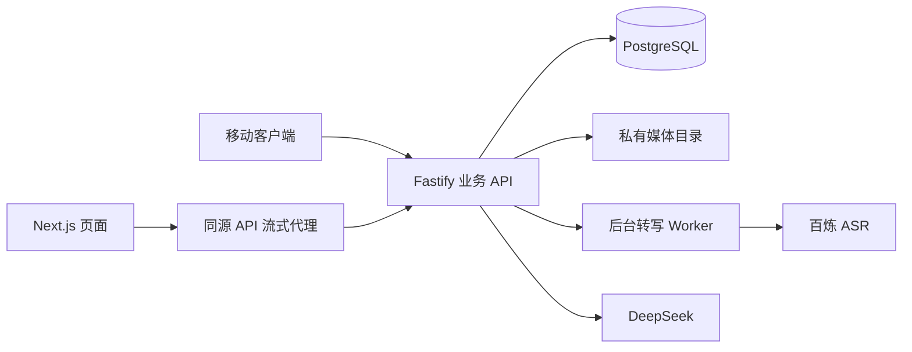

# Fastify 与 PostgreSQL 后端

更新日期：2026-11-06。Web 界面保留 Next.js 与 shadcn/ui；业务 API 和后台转写由独立 Fastify 进程提供，正式部署使用 PostgreSQL。



## 服务与目录

- `src/api/app.ts`：Fastify HTTP 适配、精确来源白名单、错误脱敏。
- `src/api/main.ts`：独立监听、环境加载、后台任务启动及退出处理。
- `src/server/http.ts`：业务路由、口令 / Cookie、输入边界与文件响应，调用原有业务服务。
- `src/server/db.ts`：异步 PostgreSQL 仓储、连接池、事务和 SQLite 只读导入；显式 `DB_DRIVER=sqlite` 仅用于隔离演示和测试。
- `src/server/transcription-queue.ts`：持久化任务、租约抢占及条件更新，正式任务保存在 PostgreSQL。
- `src/app/api/[...path]/route.ts`：只代理到后端，不读写数据库，不运行 ASR。
- `apps/api/package.json`：后端生产依赖工作区；`dist/api` 是独立构建产物。

数据库保留原有实体 ID、项目外键、完整 JSON 记录与排序，使用 JSONB 保存实体，任务状态 / 执行时间 / 租约有独立索引列。短写事务通过数据库事务锁保持原来串行核对版本后写入的行为，避免重复审核和批量删除部分成功；模型、转码和 ASR 网络等待不占用业务事务。

## Docker 运行

```bash
npm run setup
# 首次构建或代码更新
docker compose up -d --build
```

`setup` 在没有配置时生成本地数据库口令，保留已有 AI / ASR Key，不输出密钥。正式使用请配置独立的访问口令和 HTTPS。

- 网页：`http://127.0.0.1:3100`，原地址保持。
- `web`：Next.js，只配置 `API_INTERNAL_URL=http://api:3101`，不持有 AI / ASR Key、数据库连接或媒体卷。
- `api`：Fastify，内部 3101；持有业务配置、数据库连接和 `/app/data` 媒体卷。
- `db`：PostgreSQL 17，内部 5432；默认不向宿主机暴露端口。
- 既有媒体卷：`merchant-content-hub_hub-data`，原片及备份继续保留。
- 新数据库卷：`merchant-content-hub_hub-postgres`。不要执行 `docker compose down -v`。

## 旧 SQLite 数据迁移

已有部署切换前先停止写入、备份 `hub.sqlite`，并保留原镜像和媒体卷。先启动 PostgreSQL，确保导入目标为空，再启动 Fastify。Compose 为 API 设置 `LEGACY_SQLITE_PATH=/app/data/hub.sqlite`。

首次启动时，在单个 PostgreSQL 事务内按原插入顺序导入商家、项目、素材、内容、任务、操作记录、百炼远端任务及后台队列。保留审核令牌、版本、句词时间码及文件引用；兼容性处理会将仍匹配原稿的任务指纹转为不受 JSONB 键顺序影响的规范格式，远端任务编号不变。导入中任一步失败则整批回滚，不留下部分记录。

导入完成写入 `hub_migrations`；重复启动不会重新导入。目标已有业务数据而尚无导入记录时拒绝自动合并。旧 SQLite 文件保留用于回退，正常运行后不再更新它。切换后新增的数据要用 PostgreSQL 备份，不能把旧 SQLite 当成最新数据库恢复。

回退需要停止新服务并核对切换后产生的数据，再恢复原 Web 镜像与原 SQLite；不要同时运行两套写入相同媒体卷。开始切换后，请以本次实际部署核对结果为准。

## 本机开发

```bash
npm ci
npm run setup
# 独立开发项目和数据卷，不替换现有正式容器
docker compose -p merchant-content-hub-dev -f compose.yaml -f compose.dev.yaml up -d db
# 保留当前 Docker 网页时，可换开发端口
PORT=3200 API_PORT=3201 npm run dev
```

本机 `DATABASE_URL` 默认使用 127.0.0.1:5433，对应开发 Compose 暴露的端口；API 在自己的进程读取 `.env` / `.env.local`，显式进程环境优先。`npm run dev` 同时启动两个进程；退出时一并停止。也可分别运行 `npm run dev:api` 与 `npm run dev:web`。

生产本机运行：`npm run build` 后 `npm start`；单独启动后端用 `npm run start:api`。网页与后端端口可用 `PORT` / `API_PORT` 配置，跨主机时配置 `API_INTERNAL_URL`。隔离无数据库演示可显式设置 `DB_DRIVER=sqlite`，不会在 PostgreSQL 连接失败时静默回退。

## 移动端与接口

API 路径仍是 `/api/...`，客户审核页地址保持 `/review/:token`。移动端可以通过网页域名的同源代理访问，也可以在网络层配置独立的 API 域名。原生客户端可以使用已有 Bearer 接口；WebView 或浏览器跨域需在 `HUB_ALLOWED_ORIGINS` 写入完整来源，不支持通配符。

反向代理提供 HTTPS 时，把实际网页的 HTTPS 来源加入白名单。Cookie 会在 HTTPS 请求来源下使用 Secure；客户端仍需妥善保管凭据。当前依然是内部团队共享口令，尚未实现成员账号、角色与真正的多租户权限，不应把拆分框架当成账号隔离已经完成。

本次不包含安卓 APK、PostgreSQL 全文 / 向量检索、OSS、分片续传或大规模分布式任务队列；现有素材手动选择、自然语言检索、AI 文案、审核交付及异步 ASR 行为保留。

## 验证与备份

- `npm run typecheck`、`npm test`：异步业务服务、适配协议、状态机、租约和强制终止恢复；快速隔离测试显式使用 SQLite 测试库。
- `npm run test:backend`：真实 PostgreSQL 上的旧数据导入、幂等启动、事务回滚、并发审核、独立 API、来源限制和代理断开。
- `npm run test:docker`：真实 PostgreSQL 与媒体上传、审核交付、容器重启及重建后的持久化。
- `npm run test:browser`、`test:search`、`test:creation`、`test:transcription`：系统 Google Chrome 的页面与后台流程；设置 `HUB_TEST_DOCKER_IMAGE=merchant-content-hub:local` 即使用隔离三服务环境。

测试使用独立容器、网络和数据卷，不调用真实收费模型；测试结束仅清理测试资源。`HUB_TEST_DOCKER_API_IMAGE` 可指定对应后端镜像。

备份 PostgreSQL：使用 `docker compose exec -T db pg_dump -U hub -d merchant_content_hub -Fc` 写入受保护的备份文件，同时备份媒体卷。恢复前先备份当前状态并使用独立目标核对；不要将不同时间的数据库和媒体备份随意混用。
